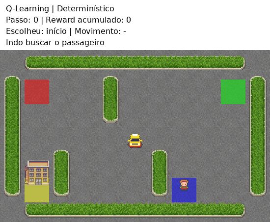
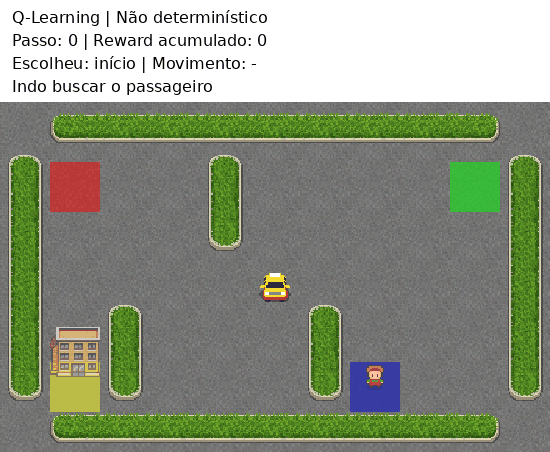
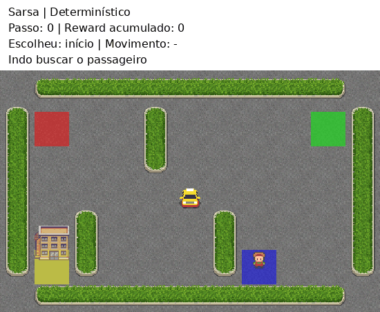

# Projeto 2 - Reinforcement Learning

O relatório está em **[Relatorio.ipynb](Relatorio.ipynb)**. Nele estão os gráficos, os resultados e as respostas das questões 1 a 5. O notebook já está executado, então dá para abrir e ver tudo sem treinar de novo.

## Ambiente Taxi-v4

Neste projeto, treinamos um táxi para buscar um passageiro e deixá-lo no destino correto. Usamos Q-Learning e Sarsa e separamos o relatório em quatro casos:

| Caso | Algoritmo | Ambiente de treino e teste |
| --- | --- | --- |
| 1 | Q-Learning | Determinístico, sem chuva |
| 2 | Sarsa | Determinístico, sem chuva |
| 3 | Q-Learning | Não determinístico, com chuva |
| 4 | Sarsa | Não determinístico, com chuva |

Cada caso tem seu próprio gráfico de aprendizado, gráfico de média e desvio padrão das ações, tabela dos testes e análise. Depois, comparamos os dois algoritmos no mesmo gráfico, como pede o enunciado. Também fizemos o teste da questão 4: usar as tabelas aprendidas sem chuva no ambiente com chuva, sem treinar novamente.

Cada caso também tem uma animação do táxi andando no notebook. Os GIFs mostram a ação escolhida, o movimento que aconteceu e o passageiro sendo buscado e entregue. Usamos a primeira Q-table de cada caso e o mesmo estado inicial nas quatro demonstrações.

| | Sem chuva | Com chuva |
| --- | --- | --- |
| Q-Learning |  |  |
| Sarsa |  |  |

Com `is_rainy=True, rainy_probability=0.6`, o táxi tem 60% de chance de seguir a direção escolhida e 20% de ir para cada lado. Se ele escolher direita e acabar indo para cima, por exemplo, a atualização continua na ação direita da Q-table, usando o estado em que ele realmente chegou.

## Estrutura

As classes e os scripts ficam em `src`, as Q-tables em `src/data` e os resultados em `src/results`, seguindo a organização dos projetos anteriores.

```text
Relatorio.ipynb
README.md
requirements.txt
img/
    taxi-<algoritmo>-<ambiente>.gif
src/
    QLearning.py
    Sarsa.py
    TaxiDriverGym.py
    Taxi-QLearning.py
    Taxi-Sarsa.py
    Taxi-Animacao.py
    data/
        q-table-Taxi-<algoritmo>-<ambiente>-<execucao>.csv
    results/
        treinamento-<algoritmo>-<ambiente>.csv
        avaliacao-<algoritmo>-<ambiente>.csv
        resumo-por-execucao.csv
        resumo-geral.csv
        configuracao.json
        caso-<algoritmo>-<ambiente>.jpg
        aprendizado-<ambiente>.jpg
        acoes-<treino>-para-<teste>.jpg
```

`TaxiDriverGym.py` executa o projeto inteiro. Para rodar só um algoritmo, use `Taxi-QLearning.py` ou `Taxi-Sarsa.py`; cada um treina nos dois ambientes.

## Como executar

Na pasta deste repositório, com Python 3.10 ou mais recente:

```powershell
python -m venv .venv
.\.venv\Scripts\python.exe -m pip install -r requirements.txt
.\.venv\Scripts\python.exe -m notebook Relatorio.ipynb
```

Para refazer todos os treinamentos e gerar os CSVs e gráficos:

```powershell
.\.venv\Scripts\python.exe src\TaxiDriverGym.py
```

Depois, abra o notebook e execute todas as células para atualizar o relatório. Também é possível refazer o treinamento pelo próprio notebook, mudando `TREINAR_NOVAMENTE` para `True`.

Para gerar só as animações, usando as Q-tables que já estão salvas:

```powershell
.\.venv\Scripts\python.exe src\Taxi-Animacao.py
```

Para treinar só um algoritmo:

```powershell
.\.venv\Scripts\python.exe src\Taxi-QLearning.py
.\.venv\Scripts\python.exe src\Taxi-Sarsa.py
```

## Configuração dos experimentos

| Parâmetro | Valor |
| --- | --- |
| Ambiente | Taxi-v4, Gymnasium 1.3.0 |
| Alpha | 0.1 |
| Gamma | 0.99 |
| Epsilon inicial | 1.0 |
| Epsilon mínimo | 0.01 |
| Decaimento de epsilon | 0.995 por episódio |
| Episódios por treinamento | 15.000 |
| Treinamentos por algoritmo e ambiente | 5 |
| Seeds de treinamento | 10, 20, 30, 40, 50 |
| Avaliações por Q-table e cenário | 100 |
| Limite por episódio | 200 ações |
| Configuração não determinística | `is_rainy=True, rainy_probability=0.6` |

Usamos os mesmos hiperparâmetros nos quatro casos. Cada treino começa com uma Q-table zerada. Nos testes, o agente escolhe a ação com maior valor (`np.argmax`) e a tabela não é alterada. Em cada caso, fizemos cinco treinos e 100 testes por Q-table. As tabelas mostram a média e o desvio padrão de cada execução. O resumo geral junta os cinco conjuntos, chegando a 500 episódios por caso. O desvio é calculado com `np.std(..., ddof=0)`, como no projeto anterior.

Se o táxi chega a 200 ações sem entregar o passageiro, o episódio termina e conta como falha. Essas tentativas entram na média geral com 200 ações. No resumo também deixamos a média apenas das entregas concluídas.

Para facilitar a leitura das curvas, usamos a média móvel de 100 episódios. Os valores originais de cada episódio estão nos CSVs. A linha em reward 8 é a meta de referência do Taxi sem chuva; nos gráficos com chuva, ela fica só para comparação.

## Referências

- [Documentação oficial do Taxi-v4](https://gymnasium.farama.org/v1.3.0/environments/toy_text/taxi/)
- [Registro do ambiente e referência de reward](https://github.com/Farama-Foundation/Gymnasium/blob/v1.3.0/gymnasium/envs/__init__.py)
